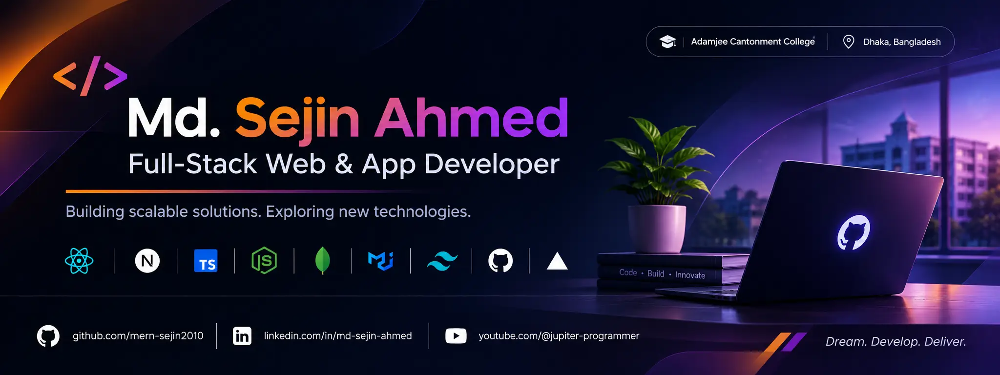

# Md. Sejin Ahmed

**Full-Stack Web & App Developer | Software Engineering Enthusiast**

I am a developer passionate about designing and building **`modern, secure, and scalable`** software applications. My interests include **`full-stack development, backend engineering, software architecture`**, and creating practical solutions through technology.

Currently pursuing my studies at **`Adamjee Cantonment College, Dhaka, Bangladesh`**, while continuously exploring new technologies and improving my engineering skills.

## About Me

- Full-Stack **Web & App** Developer.
- Student at **Adamjee Cantonment College**.
- Member of **Adamjee Cantonment College IT Club**.
- Founder of **Jupiter Programmer** and **Jupiter Lab**.
- Interested in **scalable application architecture** and **modern web technologies**.
- Aspiring **Software Engineer** focused on building meaningful technology.

## Technical Skills

### Frontend Development:

### Backend & Database:

### Mobile & Desktop Development:

### Cloud & Backend Services:

### Payments & Integrations:

### Development Tools & Deployment:

## Learning

## Projects

### Jupiter Programmer 
A personal software development project focused on building modern web applications and digital solutions.

- **Website:** [jupiter-programmer.vercel.app](https://jupiter-programmer.vercel.app)

## NPM Packages

### Jupiter Lab (@jupiter-lab/react)

A developer-focused project creating reusable packages and tools for modern web development.

- **Website:** [jupiter-lab.vercel.app](https://jupiter-lab.vercel.app)
- **NPM Package:** [@jupiter-lab/react](https://www.npmjs.com/package/@jupiter-lab/react)
- **GitHub Repository:** [npm-jupiter-lab-react](https://github.com/mern-sejin2010/npm-jupiter-lab-react)

## Education

- **Adamjee Cantonment College (ACC), Dhaka, Bangladesh**  
Higher Secondary Certificate (HSC) - Science    
2026 - Present

- **BCIC College (School Campus), Dhaka, Bangladesh**  
Secondary School Certificate (SSC) - Science  
Dhaka Education Board | 2026  
**Result:** GPA - 5.00/5.00 (Golden A+)  

## Areas of Interest

- Full-Stack Application Development
- Backend Engineering
- Software Architecture
- Developer Tools & Open Source
- Performance and Application Security

## Connect

- **GitHub:** [mern-sejin2010](https://github.com/mern-sejin2010)
- **Portfolio:** [sejin-ahmed.vercel.app](https://sejin-ahmed.vercel.app)
- **LinkedIn:** [in/md-sejin-ahmed](https://www.linkedin.com/in/md-sejin-ahmed)

## Follow

- **Company:** [jupiter-programmer.vercel.app](https://jupiter-programmer.vercel.app)
- **LinkedIn:** [company/jupiter-programmer](https://www.linkedin.com/company/jupiter-programmer)
- **YouTube:** [@jupiter-programmer](https://www.youtube.com/@jupiter-programmer)

## Contact

- **Email:** mern.sejin@gmail.com
- **Website:** [sejin-ahmed.vercel.app](https://sejin-ahmed.vercel.app)

## GitHub Analytics

## Top Languages

## Summary

## Live Metrics

---

*Building reliable software. Solving meaningful problems. Learning continuously.*

